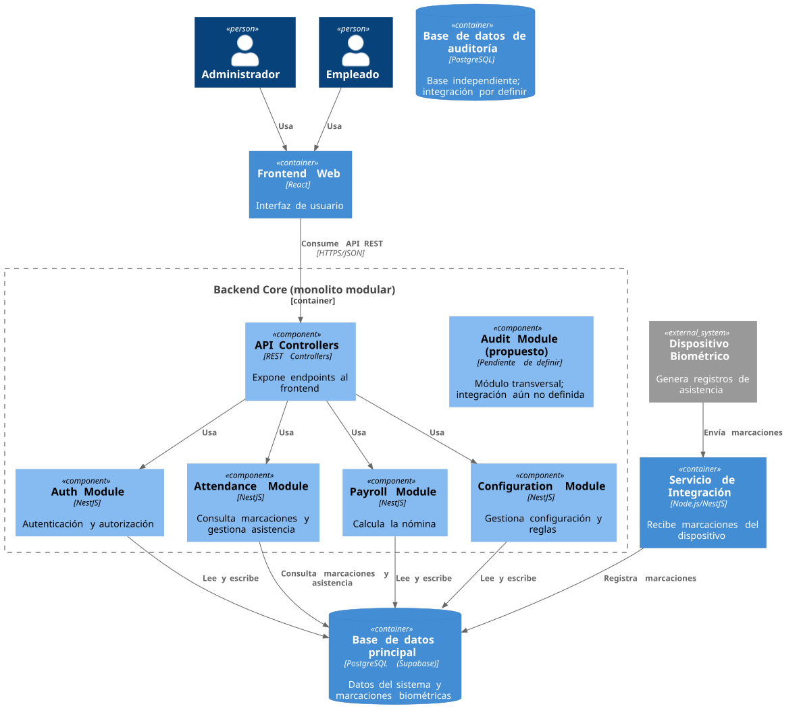

# Componentes del Backend Core (C4, Nivel 3)

Este diagrama amplía el backend core, que está organizado como monolito modular. También muestra al microservicio biométrico como contenedor independiente y las relaciones con la base principal y la base de auditoría.

[Ver fuente PlantUML](source/components-backend.puml)

## Componentes

- **API Controllers:** expone los endpoints REST que consumen los clientes.
- **Auth Module:** gestiona autenticación y autorización.
- **Attendance Module:** consulta las marcaciones y gestiona la asistencia.
- **Payroll Module:** calcula la nómina.
- **Configuration Module:** gestiona la configuración y las reglas.
- **Audit Module (propuesto):** módulo transversal cuya implementación e integración están por definir.
- **Servicio de Integración:** recibe las marcaciones del dispositivo y las registra en la base de datos principal.

## Flujo de datos

El dispositivo envía las marcaciones al servicio de integración. Este servicio las escribe directamente en la base de datos principal; el módulo de asistencia del core consulta allí esos registros. No se representa una base de integración ni un Attendance Processor porque el flujo confirmado no los utiliza.

Los módulos funcionales del core leen o escriben en la base principal según su responsabilidad. La base de auditoría es independiente y PostgreSQL, pero el flujo de eventos y la conexión con el Audit Module aún no están definidos; por eso no se dibujan relaciones de persistencia de auditoría como si estuvieran implementadas.
