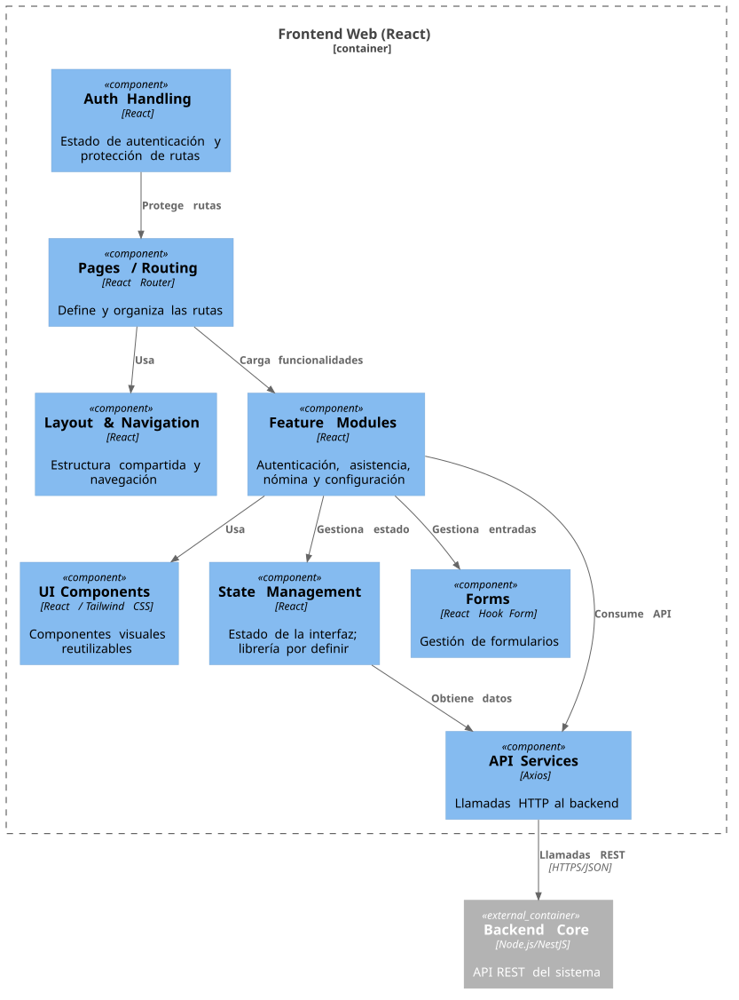

# Componentes del Frontend (C4, Nivel 3)

El diagrama desglosa el frontend React en sus responsabilidades de navegación, presentación, funcionalidades y comunicación con los servicios externos. Refleja el stack confirmado: React Router, Tailwind CSS, Axios y Supabase JS para autenticación. El frontend no consulta directamente la base de datos de SISGAL.

[Ver fuente PlantUML](source/components-frontend.puml)

## Componentes

- **Pages / Routing:** organiza las páginas y rutas mediante React Router.
- **Layout & Navigation:** estructura compartida, navegación y elementos comunes de la interfaz.
- **UI Components:** componentes reutilizables construidos con React y Tailwind CSS.
- **Feature Modules:** agrupa las funcionalidades de autenticación, asistencia, nómina y configuración.
- **State Management:** administra el estado de la interfaz; la librería no está especificada en este diagrama.
- **API Services:** centraliza las llamadas HTTP con Axios hacia el Backend Core.
- **Auth Handling:** gestiona la autenticación del frontend mediante Supabase JS y la protección de rutas. No accede a la base de datos.
- **Supabase Auth:** servicio externo utilizado por el frontend para autenticación.

## Relaciones principales

Las páginas componen el layout y cargan funcionalidades. Las funcionalidades usan componentes visuales, el manejo de estado y los servicios de API. Los servicios REST se comunican con el Backend Core mediante HTTPS/JSON. El manejo de autenticación se comunica con Supabase Auth. Las operaciones sobre los datos del sistema se realizan a través del Backend Core, sin acceso directo desde el navegador a PostgreSQL.
