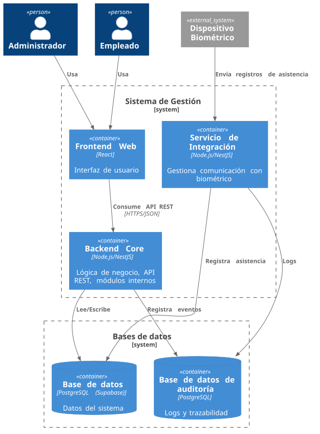

# Diagrama de contenedores (C4)

El diagrama presenta los contenedores implementados de SISGAL y sus relaciones con las personas usuarias, Supabase Auth y las bases de datos. El Backend Core es el único backend implementado y está organizado como monolito modular.

[Ver fuente PlantUML](source/containers.puml)

## Contenedores y responsabilidades

- **Frontend Web (React):** presenta la interfaz para el administrador y el empleado. Usa Supabase JS para autenticación; no consulta directamente la base de datos.
- **Backend Core (Node.js/NestJS):** expone la API REST y contiene los módulos funcionales del sistema. El monolito modular aplica a este backend.
- **Base de datos principal (PostgreSQL/Supabase):** almacena los datos del sistema.
- **Base de datos de auditoría (PostgreSQL):** está prevista como base independiente, pero aún no está conectada.
- **Supabase Auth:** servicio externo utilizado por el frontend para autenticar usuarios.

## Relaciones principales

1. El administrador y el empleado usan el frontend.
2. El frontend consume la API REST del Backend Core mediante HTTPS y JSON.
3. El frontend delega la autenticación a Supabase Auth mediante HTTPS; no accede directamente a PostgreSQL.
4. El Backend Core accede a la base principal mediante TypeORM.

> **Auditoría:** el modelo previsto se documenta en [Modelo de datos de auditoría](database.md). La base y el módulo transversal todavía no están conectados al sistema; no se representan escrituras activas.

> **Dispositivo biométrico:** no hay integración biométrica implementada. El flujo y la ubicación futura de esa integración quedan por definir.

La vista de despliegue prevista se documenta por separado en [Despliegue](deployment.md).
