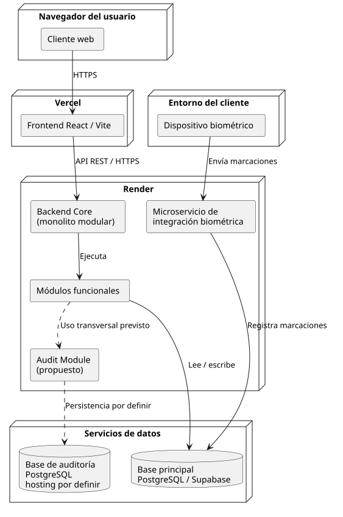

# Despliegue previsto

Esta vista representa las plataformas de destino confirmadas para el frontend y el Backend Core. Los pipelines automáticos aún no están implementados; consulta su diseño en [GitHub Actions](../deployment/github-actions.md).

[Ver fuente PlantUML](source/deployment.puml)

## Elementos

- **Vercel:** plataforma de destino del frontend React construido con Vite.
- **Render:** plataforma de destino del Backend Core.
- **Base de datos principal:** PostgreSQL alojado en Supabase, según la configuración documentada.
- **Supabase Auth:** servicio utilizado por el frontend para autenticación.
- **Base de datos de auditoría:** PostgreSQL independiente en diseño; todavía no está conectada y el alojamiento no se ha definido.
- **Dispositivo biométrico:** la integración no está implementada y no se incluye un flujo de datos.

## Relaciones

El navegador accede al frontend en Vercel. El frontend consume la API REST del Backend Core y se comunica con Supabase Auth. El Backend Core accede a la base principal. La conexión del módulo de auditoría con su base se representa como diseño pendiente; no es un flujo activo.

Las plataformas son destinos previstos. La publicación automática dependerá de configurar los workflows y secretos descritos en [Pipelines con GitHub Actions](../deployment/github-actions.md).
